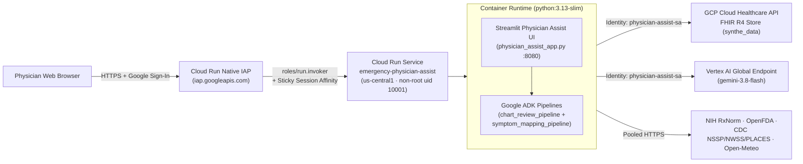

# Google Cloud Run Deployment Guide — Emergency Physician Assist & ADK Agents

This guide documents the end-to-end **Google Cloud Run** architecture, security controls, IAM configuration, and step-by-step deployment runbook performed for the **AI Physician Emergency Support** codebase (`physician_assist_app.py` + `ehr_chart_summary_agent`).

---

## 1. Cloud Deployment Architecture



### Deployed Reference Summary

| Setting | Value Configured |
| :--- | :--- |
| **GCP Project ID** | `your-gcp-project-id` (Project Number: `<PROJECT_NUMBER>`) |
| **Cloud Run Service Name** | `emergency-physician-assist` |
| **Cloud Run Region** | `us-central1` (co-located with the FHIR R4 dataset for minimal latency) |
| **Live Service URL (IAP)** | `https://emergency-physician-assist-<PROJECT_NUMBER>.us-central1.run.app` |
| **Regional Alias URL** | `https://emergency-physician-assist-ygwx6bqhua-uc.a.run.app` |
| **Runtime Service Account** | `physician-assist-sa@your-gcp-project-id.iam.gserviceaccount.com` |
| **Compute & Autoscaling** | `2 vCPU`, `2 GiB RAM`, `concurrency=20`, `timeout=300s`, `min-instances=0`, `max-instances=5` |
| **WebSocket Routing** | `--session-affinity` enabled (sticky routing for Streamlit `st.session_state`) |
| **Ingress Authentication** | Native Cloud Run **Identity-Aware Proxy (`--iap`)** (compliant with `iam.allowedPolicyMemberDomains`) |
| **FHIR R4 Store Target** | `projects/your-gcp-project-id/locations/us-central1/datasets/test/fhirStores/synthe_data` |
| **Vertex AI Model** | `gemini-3.8-flash` (`GOOGLE_CLOUD_LOCATION=global`) |

---

## 2. Key Files Involved in Cloud Deployment

| File | Purpose |
| :--- | :--- |
| [`Dockerfile`](Dockerfile) | Multi-layer `python:3.13-slim` image running as non-root `appuser` (`uid 10001`), exposing `$PORT` (`8080`), `/_stcore/health` healthcheck, and `APP_MODE` toggle (`ui` vs `adk_web`). |
| [`.dockerignore`](.dockerignore) | Excludes `.venv/`, `.git/`, `__pycache__/`, and local `.env` files so secrets never enter the Cloud Build context. |
| [`deploy_cloud_run.sh`](deploy_cloud_run.sh) | Automated one-command script that enables APIs, provisions the least-privilege service account, deploys to Cloud Run with `--session-affinity` and `--iap`, and binds IAP/Invoker IAM roles. |
| [`ehr_chart_summary_agent/swimlane_graph.py`](ehr_chart_summary_agent/swimlane_graph.py) | Supports `SWIMLANE_OUTPUT_DIR` and falls back automatically to `/tmp/swimlane_outputs` if container directories are mounted read-only. |
| [`ehr_chart_summary_agent/seed_fhir_store.py`](ehr_chart_summary_agent/seed_fhir_store.py) | Creates and populates the Cloud Healthcare dataset and FHIR R4 store (`pat-001` – `pat-007`). |

---

## 3. Prerequisites

1. **Google Cloud SDK (`gcloud`)** installed and authenticated:
   ```bash
   gcloud auth login
   gcloud auth application-default login
   gcloud config set project your-gcp-project-id
   ```
2. **Deployer IAM Permissions**: Your deploying principal needs permissions to enable services, create service accounts, set IAM bindings, submit Cloud Builds, and deploy Cloud Run services (e.g., `Project Owner` or `roles/run.admin` + `roles/iam.serviceAccountAdmin` + `roles/resourcemanager.projectIamAdmin` + `roles/cloudbuild.builds.editor` + `roles/iap.admin`).
3. **Seeded FHIR R4 Store** (if deploying to a brand-new GCP project):
   ```bash
   .venv/bin/python -m ehr_chart_summary_agent.seed_fhir_store \
     --project your-gcp-project-id \
     --location us-central1 \
     --dataset test \
     --fhir-store synthe_data
   ```

---

## 4. Option A — One-Command Automated Deployment (Recommended)

From the repository root, run [`deploy_cloud_run.sh`](deploy_cloud_run.sh):

```bash
chmod +x deploy_cloud_run.sh
./deploy_cloud_run.sh
```

### Customizing Target Project / Region / Store

You can override any parameter via environment variables without editing the script:

```bash
GOOGLE_CLOUD_PROJECT="your-gcp-project-id" \
CLOUD_RUN_REGION="us-central1" \
SERVICE_NAME="emergency-physician-assist" \
FHIR_DATASET_LOCATION="us-central1" \
FHIR_DATASET_ID="test" \
FHIR_STORE_ID="synthe_data" \
MODEL_NAME="gemini-3.8-flash" \
./deploy_cloud_run.sh
```

---

## 5. Option B — Step-by-Step Manual Deployment Runbook

Below are the exact steps executed during deployment if you wish to run or customize each phase individually.

### Step 5.1 — Set Environment Variables & Enable Required GCP APIs

```bash
export PROJECT_ID="your-gcp-project-id"
export REGION="us-central1"
export SERVICE_NAME="emergency-physician-assist"
export SA_NAME="physician-assist-sa"
export SA_EMAIL="${SA_NAME}@${PROJECT_ID}.iam.gserviceaccount.com"

gcloud services enable \
  run.googleapis.com \
  cloudbuild.googleapis.com \
  artifactregistry.googleapis.com \
  healthcare.googleapis.com \
  aiplatform.googleapis.com \
  iap.googleapis.com \
  --project="${PROJECT_ID}"
```

### Step 5.2 — Create Least-Privilege Runtime Service Account

Instead of running the clinical container under the default Compute Engine service account (which often carries broad `Editor`/`Owner` permissions), create a dedicated runtime identity with **read-only FHIR access** and **Vertex AI model invocation**:

```bash
gcloud iam service-accounts create "${SA_NAME}" \
  --display-name="Emergency Physician Assist Cloud Run Runtime SA" \
  --project="${PROJECT_ID}"

for ROLE in \
  "roles/healthcare.fhirStoreViewer" \
  "roles/healthcare.fhirResourceReader" \
  "roles/aiplatform.user" \
  "roles/logging.logWriter"; do
  gcloud projects add-iam-policy-binding "${PROJECT_ID}" \
    --member="serviceAccount:${SA_EMAIL}" \
    --role="${ROLE}" \
    --condition=None
done
```

### Step 5.3 — Build & Deploy Container from Source to Cloud Run

`gcloud run deploy --source=.` uploads the filtered repository (governed by [`.dockerignore`](.dockerignore)) to **Google Cloud Build**, builds [`Dockerfile`](Dockerfile) into **Artifact Registry**, and rolls out a new Cloud Run revision:

```bash
gcloud run deploy "${SERVICE_NAME}" \
  --source=. \
  --project="${PROJECT_ID}" \
  --region="${REGION}" \
  --service-account="${SA_EMAIL}" \
  --memory=2Gi \
  --cpu=2 \
  --concurrency=20 \
  --timeout=300 \
  --min-instances=0 \
  --max-instances=5 \
  --session-affinity \
  --iap \
  --set-env-vars="GOOGLE_GENAI_USE_VERTEXAI=TRUE,GOOGLE_CLOUD_PROJECT=${PROJECT_ID},GOOGLE_CLOUD_LOCATION=global,MODEL_NAME=gemini-3.8-flash,FHIR_DATASET_LOCATION=us-central1,FHIR_DATASET_ID=test,FHIR_STORE_ID=synthe_data,ALLOW_PUBLIC_HAPI_FALLBACK=false,USE_EXTERNAL_MCP_SERVER=false,APP_MODE=ui"
```

#### Why These Cloud Run Flags Matter
- **`--session-affinity`**: Streamlit maintains interactive UI state (`st.session_state`) over persistent WebSockets (`/_stcore/stream`). Session affinity routes reconnects to the same container instance when scaling beyond 1 instance.
- **`--iap`**: Organization policy `constraints/iam.allowedPolicyMemberDomains` blocks public unauthenticated access (`allUsers`) — which is also essential for clinical/EHR workloads. Native Cloud Run IAP enables seamless Google Sign-In directly in the browser without requiring a Load Balancer or manual OAuth client setup.
- **`ALLOW_PUBLIC_HAPI_FALLBACK=false`**: Prevents internal patient identifiers from ever falling back to the public HAPI FHIR sandbox.

### Step 5.4 — Grant IAP & Cloud Run Invoker Access to Authorized Users

Ensure both the **IAP Service Agent** (`service-<PROJECT_NUMBER>@gcp-sa-iap.iam.gserviceaccount.com`) and authorized physicians/users have invocation and IAP access:

```bash
export PROJECT_NUMBER="$(gcloud projects describe "${PROJECT_ID}" --format='value(projectNumber)')"
export USER_EMAIL="$(gcloud config get-value account)"

# Allow Cloud Run's IAP proxy service agent to invoke the container
gcloud run services add-iam-policy-binding "${SERVICE_NAME}" \
  --region="${REGION}" \
  --project="${PROJECT_ID}" \
  --member="serviceAccount:service-${PROJECT_NUMBER}@gcp-sa-iap.iam.gserviceaccount.com" \
  --role="roles/run.invoker"

# Allow your Google user to invoke and pass the IAP browser gate
gcloud run services add-iam-policy-binding "${SERVICE_NAME}" \
  --region="${REGION}" \
  --project="${PROJECT_ID}" \
  --member="user:${USER_EMAIL}" \
  --role="roles/run.invoker"

gcloud iap web add-iam-policy-binding \
  --resource-type=cloud-run \
  --service="${SERVICE_NAME}" \
  --region="${REGION}" \
  --project="${PROJECT_ID}" \
  --member="user:${USER_EMAIL}" \
  --role="roles/iap.httpsResourceAccessor"
```

---

## 6. Accessing & Operating the Cloud Application

### 6.1 Direct Web Browser Access (Recommended)
1. Open **`https://emergency-physician-assist-<PROJECT_NUMBER>.us-central1.run.app`** in Chrome/Edge/Safari.
2. Sign in with an authorized Google account (e.g., `physician@yourdomain.com`).
3. IAP automatically issues a session cookie and loads the **Emergency Physician Assist** workspace.

### 6.2 Onboarding Additional Physicians or Google Groups
To grant browser access to another clinician (`doctor@yourdomain.com`) or Google Group (`group:ed-physicians@yourdomain.com`):

```bash
gcloud iap web add-iam-policy-binding \
  --resource-type=cloud-run \
  --service=emergency-physician-assist \
  --region=us-central1 \
  --project=your-gcp-project-id \
  --member="user:doctor@yourdomain.com" \
  --role="roles/iap.httpsResourceAccessor"

gcloud run services add-iam-policy-binding emergency-physician-assist \
  --region=us-central1 \
  --project=your-gcp-project-id \
  --member="user:doctor@yourdomain.com" \
  --role="roles/run.invoker"
```

### 6.3 Local Authenticated Proxy Access (Alternative CLI Tunnel)
You can also tunnel to the Cloud Run service locally using your `gcloud` identity:

```bash
gcloud run services proxy emergency-physician-assist \
  --region=us-central1 \
  --project=your-gcp-project-id \
  --port=8080
```
Then open `http://127.0.0.1:8080`.

### 6.4 Deploying / Switching to Conversational Google ADK Web UI (`APP_MODE=adk_web`)
[`Dockerfile`](Dockerfile) supports both the Streamlit clinical UI (`APP_MODE=ui`, default) and the Google ADK conversational developer UI (`APP_MODE=adk_web`). To deploy a separate Cloud Run service for `adk web` (without rebuilding a new Dockerfile):

```bash
SERVICE_NAME="ehr-adk-web" ./deploy_cloud_run.sh
gcloud run services update ehr-adk-web \
  --region=us-central1 \
  --project=your-gcp-project-id \
  --update-env-vars="APP_MODE=adk_web"
```

---

## 7. Verification, Monitoring & Troubleshooting

### Check Service Readiness & Active URL
```bash
gcloud run services describe emergency-physician-assist \
  --region=us-central1 \
  --project=your-gcp-project-id \
  --format="yaml(status.url,status.latestReadyRevisionName,status.conditions)"
```

### Inspect Live Container Logs
```bash
gcloud run services logs read emergency-physician-assist \
  --region=us-central1 \
  --project=your-gcp-project-id \
  --limit=50
```

### Verify IAP Sign-In Redirect (`HTTP 302` to `accounts.google.com`)
```bash
curl -sI https://emergency-physician-assist-<PROJECT_NUMBER>.us-central1.run.app/ | head -n 10
```

### Common Troubleshooting

| Symptom | Cause | Resolution |
| :--- | :--- | :--- |
| **`You don't have access` screen after Google Sign-In** | User lacks `roles/iap.httpsResourceAccessor` on the Cloud Run IAP resource | Run `gcloud iap web add-iam-policy-binding --resource-type=cloud-run ...` from Section 6.2 (allow ~60 seconds for IAM propagation). |
| **`403 Forbidden` from Google Frontend after IAP login** | IAP Service Agent (`service-<PROJECT_NUMBER>@gcp-sa-iap.iam.gserviceaccount.com`) lacks `roles/run.invoker` | Run the IAP Service Agent `add-iam-policy-binding` command in Step 5.4. |
| **UI shows `Local FHIR R4 Fallback` instead of GCP Cloud Healthcare** | Runtime service account lacks `roles/healthcare.fhirResourceReader` or `FHIR_DATASET_LOCATION` mismatches store region | Verify `FHIR_DATASET_LOCATION=us-central1` and confirm `physician-assist-sa` has `roles/healthcare.fhirResourceReader`. |
| **Cold start takes ~5–10 seconds after idle period** | `min-instances=0` scales container to zero when idle (zero idle cost) | For zero-cold-start clinical ward usage, run: `gcloud run services update emergency-physician-assist --region=us-central1 --min-instances=1`. |
