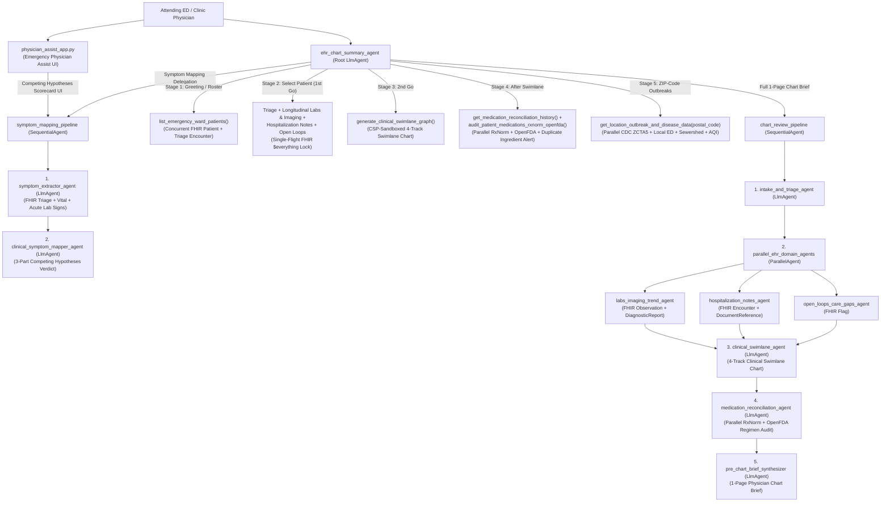

# `ehr_chart_summary_agent` — Emergency Ward Longitudinal FHIR Chart Summarizer, Medication Auditor & ZIP-Code Outbreak Intelligence Agent (Google ADK)

An interactive, multi-agent clinical decision-support system built with the **Google Agent Development Kit (`google-adk`)**, **Vertex AI (`gemini-3.8-flash`)**, and **Google Cloud Healthcare API (HL7 FHIR R4)**.

Designed for attending Emergency Department (ED) and clinic physicians, **`ehr_chart_summary_agent`** connects directly to a **GCP Cloud Healthcare FHIR R4 Store** (`Patient/$everything`), guides the physician through a **progressive, stage-by-stage conversation** (instead of overwhelming them with a single-turn data dump), audits medications via **NIH RxNorm** & **OpenFDA**, synthesizes **Interactive 4-Track Clinical Swimlane Graphs** & **1-Page Pre-Chart Briefs**, and correlates findings with **strictly 5-digit ZIP-code-level outbreak & disease surveillance**.

---

## Key Capabilities

1. **Emergency Physician Assist Interactive UI (`physician_assist_app.py`)**:
   - **Emergency Ward Roster & Quick Patient Selection**: Filterable roster of `pat-001` – `pat-007` with live FHIR chief complaints, vitals, allergies, and 5-digit ZIP codes.
   - **Guided 4-Step Progressive Clinical Investigation with Physician Validation Gate**:
     - **Step 1 — Longitudinal Medical Charts**: Triage vitals, interactive Plotly multi-date lab trend curves (`Baseline -> Peak -> Latest`), diagnostic imaging, hospitalization/consult notes, and open clinical loops (loaded concurrently via single-flight FHIR `$everything` deduplication).
     - **Step 2 — Interactive 4-Track Clinical Swimlane Chart**: Offline CSP-sandboxed HTML/SVG 4-track temporal timeline + synchronized cross-track causal matrix.
     - **Step 3 — Drugs Used & Adverse Effects + Duplicate Ingredient Alert + Physician Validation Gate**: Single-call parallel NIH RxNorm Generic vs. Brand + OpenFDA SPL/FAERS regimen audit (`audit_patient_medications_rxnorm_openfda`), deterministic **Duplicate Active Ingredient Safety Hazard** detection across active and leftover stopped/held prescriptions, and an explicit **Physician Validation Gate** before unlocking Step 4.
     - **Step 4 — 5-Digit ZIP-Code Outbreak & Infection Surveillance**: Unlocked after Step 3 physician validation; queries CDC NSSP Local ED trajectories, CDC NWSS Sewershed Wastewater PCR pathogens, CDC PLACES ZCTA5 prevalence, and Open-Meteo hyperlocal air quality in parallel.
   - **Competing Hypotheses Scorecard UI + Google ADK Symptom Agents**: Groups presenting symptoms, abnormal vitals, and acute lab derangements into **3 ranked Root-Cause Hypothesis Cards** (*Medication / Adverse Effects*, *Chronic EHR Baseline*, and *Hyperlocal ZIP Outbreak*) with `✓ Explains` / `✗ Cannot Explain` / `★ Resolves Drug Gap` chips, **1-click bedside verdicts**, a dedicated **3-Column Competing Hypotheses Scorecard & Checkmark Grid** tab, and a concise 3-part **AI Clinical Verdict** powered by `symptom_mapping_pipeline`.
2. **Conversational Multi-Agent ADK Workflow (`adk web` / `adk run`)**:
   - **Stage 1 (Greeting & Ward Roster)**: Introduces agent capabilities and pulls the live Emergency Ward patient roster (`pat-001` – `pat-007`) from FHIR with chief complaints and residential ZIP codes.
   - **Stage 2 (Select Patient — 1st Go: Triage + Longitudinal Labs, Imaging, Hospitalization Notes & Open Loops)**: Retrieves the patient's FHIR triage vitals, intake note, allergies, active problem list, multi-date lab trajectories (`Baseline -> Peak -> Latest`), diagnostic imaging (`CT`, `TTE Echo`, `CXR`), hospitalization/consult notes, and unresolved open clinical loops (`Flag`).
   - **Stage 3 (Swimlane Charts — 2nd Go)**: Generates the **Interactive 4-Track Clinical Swimlane Chart** (Mermaid + Markdown temporal matrix + HTML/SVG viewer + cross-track causal links).
   - **Stage 4 (Check Drugs & Adverse Effects — Initiated Only After Swimlane Charts)**: Executes a parallel full-regimen reconciliation and RxNorm/OpenFDA audit (`audit_patient_medications_rxnorm_openfda`), flags brand-vs-generic duplicate active ingredients, and details boxed warnings, adherence barriers, and known adverse effects.
   - **Stage 5 (Hyperlocal Patient 5-Digit ZIP-Code Outbreak Surveillance & 1-Page Brief)**: Queries **strictly the patient's 5-digit ZIP code (`postal_code`)** — combining **CDC PLACES ZCTA5 (`qnzd-25i4`)**, **CDC NSSP Local Hospital ED Trajectories (`rdmq-nq56`)**, **CDC NWSS Local Sewershed Wastewater Pathogens**, and **Open-Meteo Hyperlocal Air Quality**, or delegates to `chart_review_pipeline` for a full **1-Page Physician Chart Brief**.
   - **Next-Stage Guidance & Verifiable Citations**: Every turn ends with actionable **Suggested Next Steps** and cites exact FHIR resource IDs (no private FHIR links) plus clickable URLs for all external public health and drug APIs.

---

## Multi-Agent Architecture



---

## Repository Structure

```text
AI-PhysicianSupport/
├── README.md
├── CLOUD_RUN_DEPLOYMENT_GUIDE.md                 # End-to-end Google Cloud Run deployment & IAP operations guide
├── DEMO_GUIDE.md                                 # Click-by-click live demo script & presenter talk track
├── DEMO_SLIDES.html                              # 10-slide interactive HTML presentation deck (speaker notes + PDF print)
├── requirements.txt
├── Dockerfile                                    # Non-root Python 3.13 Cloud Run container (Streamlit UI + ADK Web)
├── .dockerignore                                 # Excludes .venv, .git, and .env secrets from Cloud Build context
├── deploy_cloud_run.sh                           # One-command Google Cloud Run deployment (least-privilege SA + IAP)
├── physician_assist_app.py                       # Emergency Physician Assist Web UI (Roster + 4-Step Gate + Separate Symptom Mapper UI)
├── run_demo.py                                   # CLI runner (live ADK + --offline deterministic trace)
├── outputs/                                      # Generated Interactive 4-Track HTML/SVG Swimlane Viewers
│   └── clinical_swimlane_pat-005.html
└── ehr_chart_summary_agent/                      # Google ADK Agent Package
    ├── __init__.py
    ├── .env.example                              # Template environment variables
    ├── agent.py                                  # Root agent (`ehr_chart_summary_agent`)
    ├── clinical_tools.py                         # FHIR profile, RxNorm/OpenFDA & ZIP-code outbreak tools
    ├── ehr_chart_tools.py                        # FHIR longitudinal EHR compartment & swimlane tools
    ├── symptom_mapping_tools.py                  # Progressive FHIR symptom extraction & multi-stage etiology mapper
    ├── fhir_cohort_data.py                       # Canonical HL7 FHIR R4 builder for `pat-001`..`pat-007`
    ├── seed_fhir_store.py                        # Creates & populates GCP Cloud Healthcare FHIR R4 store
    ├── server.py                                 # GCP FHIR HTTP helpers & FastMCP tool server
    ├── swimlane_graph.py                         # Dynamic 4-Track Mermaid, Matrix & XSS-safe HTML/SVG builder
    ├── workflow.py                               # ADK Graph Workflow definition
    └── sub_agents/
        ├── chart_summarizer_pipeline/            # Sequential + Parallel 1-Page Chart Brief pipeline
        ├── symptom_mapper/                       # Google ADK Symptom Extractor + Progressive Etiology Mapper pipeline
        ├── drug_brand_checker/                   # NIH RxNorm + OpenFDA specialist sub-agent
        ├── get_adverse_effects/                  # FAERS adverse event sub-agent
        ├── get_medication_details/               # FHIR medication lookup sub-agent
        ├── outbreak_surveillance/                # Hyperlocal 5-digit ZIP-code surveillance sub-agent
        └── patient_fhir_profile/                 # FHIR $everything clinical profile sub-agent
```

---

## 1. Prerequisites & Installation

- **Python**: `3.11+` (`3.12` – `3.14` supported)
- **Google Cloud SDK (`gcloud`)**: Installed for Vertex AI & Cloud Healthcare FHIR API authentication

```bash
# 1. Clone the repository
git clone https://github.com/Sivaram0606/AI-PhysicianSupport.git
cd AI-PhysicianSupport

# 2. Create and activate a virtual environment
python3 -m venv .venv
source .venv/bin/activate

# 3. Install dependencies
pip install -r requirements.txt
```

---

## 2. Environment Configuration (`.env`)

Copy `.env.example` to `ehr_chart_summary_agent/.env` and set your GCP Project ID and FHIR dataset location:

```bash
cp ehr_chart_summary_agent/.env.example ehr_chart_summary_agent/.env
```

Edit `ehr_chart_summary_agent/.env`:

```env
GOOGLE_GENAI_USE_VERTEXAI=TRUE
GOOGLE_CLOUD_PROJECT=your-gcp-project-id
GOOGLE_CLOUD_LOCATION=global
MODEL_NAME=gemini-3.8-flash

# Google Cloud Healthcare API (FHIR R4 Store) Configuration
FHIR_DATASET_LOCATION=us-central1   # or asia-east1 depending on your dataset region
FHIR_DATASET_ID=test
FHIR_STORE_ID=synthe_data

# Security & MCP Transport Controls (Optional — secure defaults shown)
ALLOW_PUBLIC_HAPI_FALLBACK=false
USE_EXTERNAL_MCP_SERVER=false
MCP_SERVER_URL=http://127.0.0.1:8080/mcp
```

> **Note on `GOOGLE_CLOUD_LOCATION=global`**: `gemini-3.8-flash` on Vertex AI uses the `global` endpoint (`locations/global/publishers/google/models/gemini-3.8-flash`).

---

## 3. How to Create & Populate the GCP Cloud Healthcare FHIR R4 Store

The included [`seed_fhir_store.py`](ehr_chart_summary_agent/seed_fhir_store.py) script automatically creates the **Cloud Healthcare Dataset**, creates the **FHIR R4 Store** (if they do not already exist), and upserts all **7 longitudinal patient cohorts (`pat-001` – `pat-007`)** across 9 HL7 FHIR R4 resource types (`Patient`, `Encounter`, `DocumentReference`, `Condition`, `AllergyIntolerance`, `MedicationRequest`, `Observation`, `DiagnosticReport`, and `Flag`).

### Step 3.1 — Authenticate & Enable Required GCP APIs

```bash
# Authenticate your user credentials for Application Default Credentials (ADC)
gcloud auth login
gcloud auth application-default login

# Set your active GCP project
export PROJECT_ID="your-gcp-project-id"
gcloud config set project "$PROJECT_ID"

# Enable the Cloud Healthcare API and Vertex AI API
gcloud services enable healthcare.googleapis.com aiplatform.googleapis.com --project="$PROJECT_ID"
```

### Step 3.2 — Ensure Required IAM Roles (if not Project Owner/Editor)

Your authenticated principal needs:
- `roles/healthcare.datasetAdmin` and `roles/healthcare.fhirResourceEditor` (to create the dataset/store and read/write FHIR resources)
- `roles/aiplatform.user` (to invoke `gemini-3.8-flash` on Vertex AI)

### Step 3.3 — Run the FHIR Store Seeder

```bash
python -m ehr_chart_summary_agent.seed_fhir_store \
  --project "$PROJECT_ID" \
  --location us-central1 \
  --dataset test \
  --fhir-store synthe_data
```

*(If you already configured `ehr_chart_summary_agent/.env`, you can simply run `python -m ehr_chart_summary_agent.seed_fhir_store` with no flags.)*

### Step 3.4 — Verify Seeded FHIR Resources (Optional)

```bash
curl -s -H "Authorization: Bearer $(gcloud auth application-default print-access-token)" \
  "https://healthcare.googleapis.com/v1/projects/${PROJECT_ID}/locations/us-central1/datasets/test/fhirStores/synthe_data/fhir/Patient" | head -n 40
```

> **Automatic Local FHIR R4 Fallback**: If GCP credentials are not configured or offline, all tools automatically fall back to identical in-memory HL7 FHIR R4 `Patient/$everything` bundles built by [`fhir_cohort_data.py`](ehr_chart_summary_agent/fhir_cohort_data.py) so local testing and demos always work out of the box.

---

## 4. Commands to Start & Run the App

Run all commands below from the **repository root (`AI-PhysicianSupport/`)** with your virtual environment activated (`source .venv/bin/activate`, or prefix commands with `.venv/bin/`):

### Option A — Launch the Emergency Physician Assist Web UI (Recommended Clinical Workspace)

```bash
.venv/bin/streamlit run physician_assist_app.py
```

1. Open **`http://localhost:8501`** in your browser.
2. Select a patient from the **Emergency Ward Roster** (`pat-001` – `pat-007`) or header dropdown.
3. Step progressively through **Step 1 (Longitudinal Medical Charts)** $\rightarrow$ **Step 2 (4-Track Clinical Swimlane)** $\rightarrow$ **Step 3 (Drugs & Adverse Effects + Duplicate Active-Ingredient Alert + Physician Validation Gate)** $\rightarrow$ **Step 4 (5-Digit ZIP-Code Outbreak Surveillance)** while reviewing the **Separate Symptom Mapping Agent UI** in the side panel or dedicated **Symptom Mapping Matrix** tab.

### Option B — Launch the Interactive ADK Conversational Web UI (`adk web`)

```bash
.venv/bin/adk web
```

1. Open **`http://127.0.0.1:8000`** in your browser.
2. In the top-left agent selector dropdown, choose **`ehr_chart_summary_agent`**.
3. Start chatting with **`Hi`** to view capabilities and the 7-patient Emergency Ward roster!

*(To run on a custom port, e.g., `8085`: `.venv/bin/adk web --host 127.0.0.1 --port 8085`)*

### Option C — Launch Interactive Terminal Chat (`adk run`)

```bash
.venv/bin/adk run ehr_chart_summary_agent
```

### Option D — Launch ADK FastAPI Backend Server (`adk api_server`)

```bash
.venv/bin/adk api_server --host 127.0.0.1 --port 8000
```

### Option E — Run the CLI Demo Script (`run_demo.py`)

```bash
# List all 7 Emergency Ward patients from FHIR
.venv/bin/python run_demo.py --list

# Run live multi-agent 1-Page Chart Brief + 4-Track Swimlane via Vertex AI
.venv/bin/python run_demo.py --patient pat-005

# Run deterministic local FHIR + RxNorm/OpenFDA + ZIP-Outbreak trace (no LLM key needed)
.venv/bin/python run_demo.py --patient pat-005 --offline
```

### Option F — Run the Headless FastMCP Tool Server (Optional — External MCP Clients Only)

```bash
.venv/bin/python -m ehr_chart_summary_agent.server
```

> **Note**: `server.py` is a **headless Model Context Protocol (MCP) backend** listening on `http://127.0.0.1:8080/mcp` for external MCP clients (opening `http://127.0.0.1:8080/` in a browser will return `404 Not Found`). You **do not** need to run `server.py` to use `physician_assist_app.py`, `adk web`, or `run_demo.py` — all ADK agents bind pooled Python tools directly in-process by default unless `USE_EXTERNAL_MCP_SERVER=true` is set.

### Option G — Deploy & Run on Google Cloud Run (`deploy_cloud_run.sh`)

```bash
./deploy_cloud_run.sh
```

- Builds the non-root `Dockerfile` via Google Cloud Build, provisions a dedicated least-privilege runtime Service Account (`physician-assist-sa`), configures `--session-affinity` for Streamlit WebSocket state + native **Identity-Aware Proxy (`--iap`)** for Google Sign-In browser access, and deploys **`emergency-physician-assist`** to `us-central1`.
- See [`CLOUD_RUN_DEPLOYMENT_GUIDE.md`](CLOUD_RUN_DEPLOYMENT_GUIDE.md) for the complete architecture diagram, manual step-by-step IAM/IAP runbook, team onboarding commands, and troubleshooting guide.
- You can also connect via local authenticated Cloud Run proxy anytime:
  ```bash
  gcloud run services proxy emergency-physician-assist --region=us-central1 --port=8080
  ```

---

## 5. Seeded Emergency Ward Patient Cohort (`pat-001` – `pat-007`)

| Patient ID | Patient Name | Location & ZIP | Chief Complaint Today | Key Clinical, Medication & Longitudinal Insights in FHIR |
| :--- | :--- | :--- | :--- | :--- |
| **`pat-001`** | **Alex Jordan Conn** (48M) | Boston, MA `02118` | Acute shortness of breath, wheezing & 3-day dry cough | • **ACEi Cough / Asthma Flare**: Lisinopril doubled to 10mg on 10/08 (`PEF 54%`, `Eos 520`).<br>• **Duplicate Active Ingredient**: Taking OTC brand **Tylenol** + leftover generic **Acetaminophen** (`ALT 22 -> 58 U/L`).<br>• **High-Criticality Allergy**: Sulfonamide antibiotics. |
| **`pat-002`** | **Maria Elena Reynolds** (62F) | Portland, OR `97205` | Proximal thigh weakness, dark urine & dizziness | • **CYP3A4 Statin Rhabdomyolysis**: Outside Urgent Care prescribed Clarithromycin without holding brand **Lipitor** (`CK 110 -> 4,850 U/L`).<br>• **Myoglobinuric AKI**: `Cr 0.85 -> 1.92` — requires immediate hold of both **Lipitor** and generic **Metformin ER**. |
| **`pat-003`** | **David Raj Patel** (41M) | San Francisco, CA `94108` | Severe epigastric pain, melena & orthostasis (`BP 98/62`) | • **NSAID Upper GI Bleed**: Self-escalated brand **Advil** to `2,400 mg/day` after previously stopping **Prilosec**.<br>• **Critical Lab Drop**: `Hemoglobin 14.6 -> 8.4 g/dL`, `BUN 46 mg/dL`. |
| **`pat-004`** | **Evelyn Grace Carter** (70F) | Austin, TX `78701` | Persistent 45-min epistaxis, bruising & AFib (`HR 112`) | • **Warfarin Toxicity**: Missed 2 Anticoagulation Clinic visits + started OTC cranberry/garlic supplements (`INR 2.4 -> 6.4`).<br>• **Transition Candidate**: Hold brand **Coumadin**, give Vitamin K, transition to DOAC. |
| **`pat-005`** *(alias `PAT-1001`)* | **Arthur Pendelton** (68M) | Chicago, IL `60611` | Worsening dyspnea on exertion & `+7.5 lb` ankle edema | • **Adherence & PA Barriers**: Self-cut **Lasix** `40mg -> 20mg`; never started **Jardiance** (`$180` Prior Auth block); `NT-proBNP 920 -> 1,850`.<br>• **Renal Recovery Unlocks Held GDMT**: **Lisinopril** & **Metformin** held for hospital AKI (`Cr 2.30`), now `Cr 1.50` (`eGFR 48`) — eligible for Entresto & Metformin.<br>• **Dropped Nodule Follow-Up**: Unordered 6-month CT for 7mm RUL lung nodule. |
| **`pat-006`** *(alias `PAT-1002`)* | **Elena Rostova** (54F) | Seattle, WA `98104` | Severe fatigue, nausea & abnormal labs | • **Methotrexate Hepatotoxicity**: Dose increase `15 -> 20mg/wk` spiked `ALT 92 / AST 78 U/L`.<br>• **Chelation Malabsorption**: Taking morning **Ferrous Sulfate** simultaneously with **Synthroid**, spiking `TSH 2.4 -> 6.8`.<br>• **Stalled Biologic**: Indeterminate QuantiFERON-TB while on Prednisone taper stalled Humira. |
| **`pat-007`** *(alias `PAT-1003`)* | **Marcus Vance** (42M) | Denver, CO `80203` | Bilateral calf cramps, weakness & `BP 168/102` post-ER | • **Critical Drug-Lab Alert**: ER started potassium-wasting **Chlorthalidone 25mg** despite `K+ 3.2 mEq/L`.<br>• **Unreviewed Send-Out Lab**: August `Aldosterone-to-Renin Ratio (ARR = 95)` confirms **Primary Hyperaldosteronism (Conn's Syndrome)**. |

---

## 6. Sample Questions & Multi-Turn Walkthrough

### Flow 1 — Progressive Stage-by-Stage Emergency Ward Consultation (Recommended)

**Turn 1 — Greeting & Emergency Ward Roster**
```text
Hi
```
*(Agent introduces its 5 capabilities, queries FHIR for `pat-001` – `pat-007`, displays the Emergency Ward patient table with Chief Complaints and ZIP codes, and suggests selecting a patient.)*

**Turn 2 — Select a Patient (1st Go: Triage + Longitudinal Lab Trends, Diagnostic Imaging, Hospitalization Notes & Open Clinical Loops)**
```text
Select pat-001 (Alex Jordan Conn)
```
*(Agent presents Alex's triage vitals, allergies, active conditions, multi-date longitudinal lab trends, diagnostic imaging, hospitalization/consult notes, and unresolved open clinical loops — without initiating drug checks yet — and prompts to generate the **4-Track Clinical Swimlane Chart** next.)*

**Turn 3 — Interactive 4-Track Clinical Swimlane Chart (2nd Go)**
```text
Yes, generate the 4-track clinical swimlane chart
```
*(Agent renders the synchronized 4-Track Mermaid + Markdown Swimlane + saves `outputs/clinical_swimlane_pat-001.html`, then asks to initiate the **Check Drugs, Brand vs. Generic & Adverse Effects** audit next.)*

**Turn 4 — Check Drugs, Brand vs. Generic & Adverse Effects (Initiated After Swimlane Charts)**
```text
Yes, check his drugs and their adverse effects
```
*(Agent reconciles active, held, and stopped medications, verifies **ORIGINAL DRUG NAME (GENERIC) vs. BRAND NAME** via NIH RxNorm, reports OpenFDA uses/boxed warnings/FAERS adverse effects, and correlates them with his lab trends and swimlane events.)*

**Turn 5 — Hyperlocal Patient ZIP-Code Outbreak & Disease Surveillance**
```text
Check for any active outbreaks and persistent diseases in his zip code
```
*(Agent queries strictly ZIP code `02118` via CDC PLACES ZCTA5, local hospital ED trajectories, local sewershed pathogen detections, and ZIP air quality.)*

---

### Additional Copy-Paste Sample Queries

- **Full 1-Page Pre-Chart Brief via Multi-Agent Pipeline (`SequentialAgent` + `ParallelAgent`)**:
  ```text
  Generate a complete 1-page physician chart brief for pat-007 (Marcus Vance)
  ```
- **Drug-Induced Rhabdomyolysis & Brand/Generic Audit**:
  ```text
  Review pat-002 Maria Elena Reynolds — check her patient profile, medications (whether drug or brand name), and adverse effects
  ```
- **Methotrexate Hepatotoxicity + Thyroid Malabsorption Case**:
  ```text
  Select pat-006 Elena Rostova and review her medications, adherence issues, and longitudinal lab trends
  ```
- **Asthma + Duplicate Brand/Generic Acetaminophen + Boston `02118` ZIP Outbreaks**:
  ```text
  Select pat-001 Alex Jordan Conn, then check outbreaks in his zip code 02118
  ```
- **Bedside Name-Mismatch Safety Verification**:
  ```text
  Patient ID: pat-001, Name: John Smith. Presenting with wheezing and cough.
  ```

---

## 7. Open-Source Clinical & Public Health APIs Used

| Domain | API / Data Source | Granularity & Purpose |
| :--- | :--- | :--- |
| **Longitudinal EHR** | **Google Cloud Healthcare FHIR R4 (`Patient/$everything`)** | Demographics, Triage, Encounters, Notes, Meds, Labs, Imaging, Open Loops *(cited by FHIR Resource ID)* |
| **Drug Nomenclature** | **NIH NLM RxNorm REST API** (`rxnav.nlm.nih.gov`) | Verifies **Original Drug Name (Generic)** (`IN`/`SCD`) vs. **Brand Name** (`BN`/`SBD`) & active ingredients |
| **Drug Uses & Side Effects** | **OpenFDA Drug Label & FAERS APIs** (`api.fda.gov/drug/`) | Official SPL indications, pharmacologic class, boxed warnings, contraindications & top FAERS adverse events |
| **ZIP Persistent Diseases** | **CDC PLACES ZCTA5 API** (`data.cdc.gov/resource/qnzd-25i4.json`) | Exact **5-digit ZIP code** population & chronic/endemic disease prevalence |
| **Local ED Outbreaks** | **CDC NSSP Emergency Dept Trajectories** (`data.cdc.gov/resource/rdmq-nq56.json`) | Weekly local hospital ED visit % & trends (`Increasing`/`Decreasing`/`No Change`) for Flu, COVID-19 & RSV serving the ZIP code |
| **Local Wastewater Pathogens** | **CDC NWSS Wastewater Surveillance** (`ymmh-divb`, `j9g8-acpt`, `45cq-cw4i`, `akvg-8vrb`, `xpxn-rzgz`) | Real-time PCR viral concentrations & surges (Influenza A, SARS-CoV-2, RSV, Measles, Mpox) in the local sewershed serving the ZIP code |
| **ZIP Air Quality** | **Open-Meteo Air Quality API** (`air-quality-api.open-meteo.com`) | Hyperlocal US AQI, `PM2.5`, `PM10`, `Ozone` & `NO2` at exact ZIP coordinates |

---

## 8. Performance, Efficiency & Security Architecture

### Agent & Data-Layer Efficiency
- **Single-Flight FHIR `$everything` Deduplication (`6x -> 1x` GCP HTTP Request)**: Per-patient single-flight locks (`_FHIR_INFLIGHT_LOCKS`) and a 90s TTL cache (`_FHIR_BUNDLE_CACHE`) in `ehr_chart_tools.py` collapse concurrent `ParallelAgent` and UI compartment reads into a single GCP Cloud Healthcare `$everything` call (`<0.1 ms` warm).
- **Thread-Safe OAuth2 & HTTP Connection Pooling**: Singleton GCP `AuthorizedSession` (`HTTPAdapter(pool_connections=12, pool_maxsize=16)`) in `server.py` and shared pooled `_HTTP_SESSION` + TTL caches (`_ROSTER_CACHE`, `_DRUG_CACHE`, `_OUTBREAK_CACHE`) in `clinical_tools.py` eliminate repeated ADC token handshakes and TCP/TLS setup overhead.
- **Single-Call Parallel Medication Regimen Audit**: `audit_patient_medications_rxnorm_openfda(patient_id)` audits all active and held/stopped medications concurrently across NIH RxNorm (`properties.json` + `related.json`) and OpenFDA (`SPL Label` + `FAERS`) in **1 LLM tool call** while deterministically flagging cross-status brand-vs-generic duplicate active ingredients (e.g., `Tylenol` + leftover `Acetaminophen`).
- **Concurrent 4-Source ZIP Surveillance & Streamlined ADK Execution**: `get_location_outbreak_and_disease_data` runs `CDC PLACES ZCTA5`, `CDC NSSP ED`, `CDC NWSS Wastewater`, and `Open-Meteo AQI` concurrently; `symptom_mapping_pipeline` reuses a singleton `InMemoryRunner` with a `ParallelAgent` intake stage; and `root_agent` binds direct in-process tools to avoid redundant 1-tool sub-agent handoffs.

### Security Architecture Hardening
- **GCP Healthcare SSRF & Dot-Segment Path Traversal Prevention (`CWE-22` / `CWE-918`)**: Strict leading-alphanumeric identifier validation (`^[A-Za-z0-9][A-Za-z0-9._\-]{0,63}$`), explicit `".."` rejection, and `urllib.parse.quote(..., safe="")` protect all GCP Healthcare URL builders across `server.py`, `ehr_chart_tools.py`, `clinical_tools.py`, and `seed_fhir_store.py`.
- **PHI-Safe Logging & Public HAPI Exfiltration Lockdown (`CWE-200` / `CWE-532`)**: Raw FHIR HTTP response bodies are stripped from error logs (logging HTTP status codes only), and fallback of internal patient IDs to public `https://hapi.fhir.org` is disabled by default (`ALLOW_PUBLIC_HAPI_FALLBACK=false`).
- **OpenFDA Lucene & CDC Socrata SoQL Injection Guards**: Drug query terms are sanitized via `_sanitize_lucene_term` with bounded `(4, 10)` socket timeouts, and Socrata `$where` clauses enforce finite WGS84 bounds (`_validate_coords`) and strict 5-digit FIPS validation (`^\d{5}$`).
- **Offline Swimlane CSP Sandbox & `OWASP LLM01` Prompt Isolation**: Generated clinical swimlane HTML embeds `Content-Security-Policy: default-src 'none'; ... connect-src 'none'` alongside `html.escape()` XSS sanitization; `server.py` binds exclusively to `127.0.0.1`; and ADK agent prompts isolate untrusted EHR/FDA free-text while sanitizing XML tags on `<physician_bedside_note>`.

